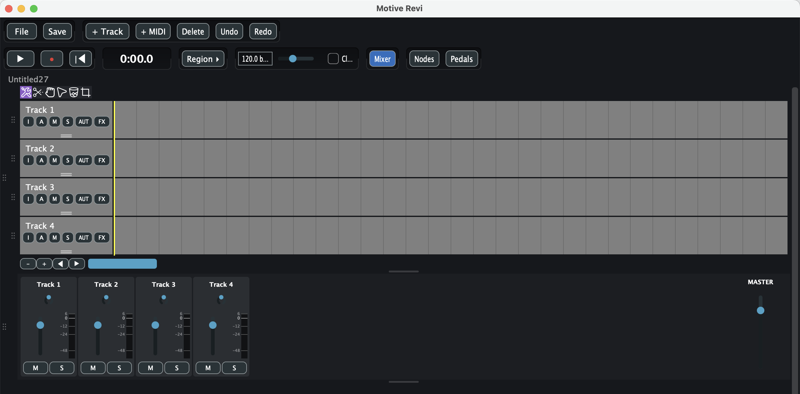
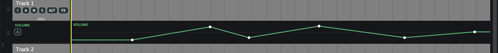
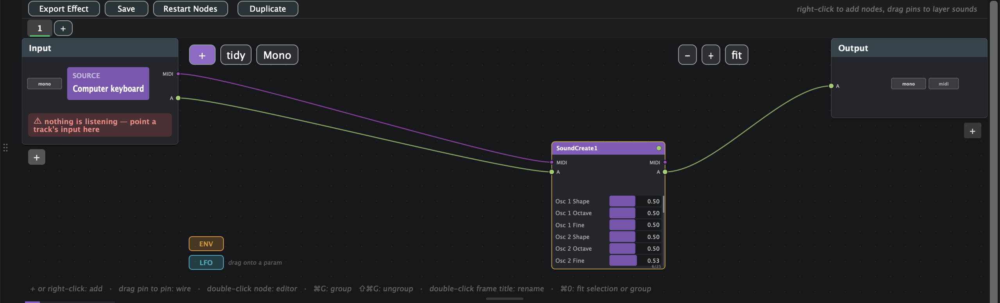
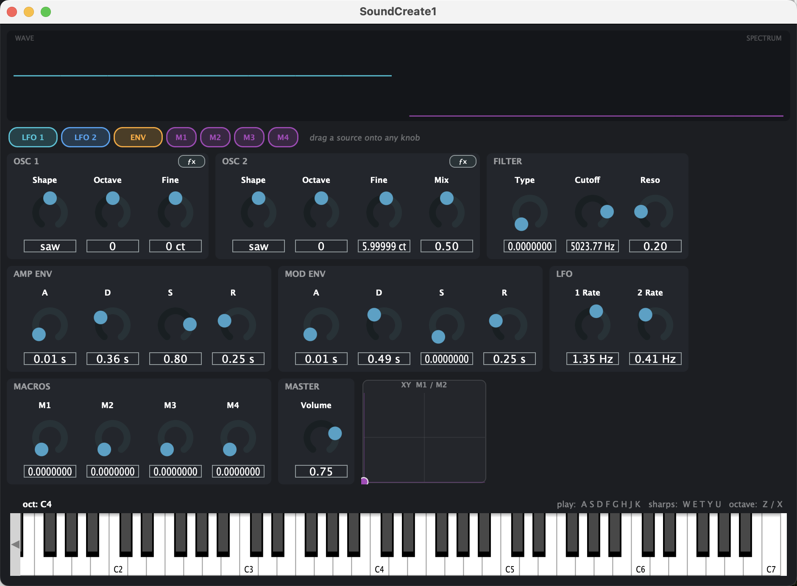
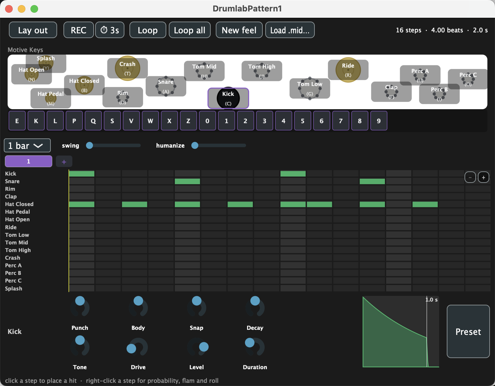
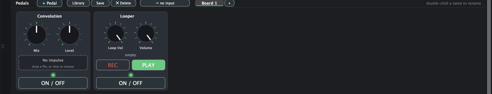

# T-HISS

A lean, fast DAW for **Mac and Windows** — timeline, mixer, a node-based patching canvas, a
synth designer, a drum machine, a pedalboard, and LAN collaboration. Everything
that makes sound is something T-HISS owns: no third-party plugins, so a
project opens and sounds the same on every machine.

## ⬇ Download

**[Get the latest version from the Releases page](../../releases/latest)** and pick the file for your computer:

| Your computer | Download |
|---|---|
| Mac (Apple Silicon or Intel, macOS 12 Monterey or newer) | `T-HISS-…-mac.zip` |
| Windows 10 / 11 PC (Intel / AMD — most PCs) | `T-HISS-…-windows-x64.zip` |
| Windows 11 on ARM (Snapdragon, Surface Pro 11 …) | `T-HISS-…-windows-arm64.zip` |

Unzip it and run it — nothing to install or compile. Not available for Linux yet.

---

## Contents

- [Installing](#installing)
- [Quick start](#quick-start)
- [The window at a glance](#the-window-at-a-glance)
- [Toolbar — row 1](#toolbar--row-1-project--editing)
- [Toolbar — row 2](#toolbar--row-2-transport--panels)
- [The tool row](#the-tool-row)
- [Tracks and track headers](#tracks-and-track-headers)
- [The timeline](#the-timeline)
- [Automation lanes](#automation-lanes)
- [Nodes — the patching canvas](#nodes--the-patching-canvas)
- [SoundCreate — the synth](#soundcreate--the-synth)
- [DrumLab — the drum machine](#drumlab--the-drum-machine)
- [Where MIDI lives](#where-midi-lives)
- [The piano roll](#the-piano-roll)
- [Pedals — the pedalboard](#pedals--the-pedalboard)
- [Mixer](#mixer)
- [Effects and instruments](#effects-and-instruments)
- [MotiveScript](#motivescript)
- [The File menu](#the-file-menu)
- [Rooms — collaborating](#rooms--collaborating)
- [Audio & MIDI setup](#audio--midi-setup)
- [Keyboard shortcuts](#keyboard-shortcuts)
- [Where your files live](#where-your-files-live)

---

## Installing

### Mac

1. Download the Mac zip from the [Releases page](../../releases/latest) and unzip it.
2. Drag **T-HISS** to your **Applications** folder and double-click it.
3. **First launch:** if macOS says it can't be opened, go to **System Settings → Privacy & Security**,
   scroll down and click **Open Anyway**. (On older macOS: right-click the app → **Open** → **Open**.)

> **Why the extra step?** The app isn't signed with an Apple Developer
> certificate yet, so macOS asks once before opening it. You only have to do this once.
>
> If macOS still refuses, run this once in Terminal:
> ```bash
> xattr -dr com.apple.quarantine "/Applications/T-HISS.app"
> ```

**Microphone access.** On first launch macOS asks for microphone permission —
this is what lets the app record from your audio interface or mic. If you
decline, everything else still works (playback, MIDI, the transport). To grant
it later: System Settings → Privacy & Security → Microphone, then reopen
**File → Audio Devices** or restart the app.

**Requirements:** macOS 12 (Monterey) or later. The Mac download is **universal**,
so it runs on both Apple Silicon (M1 or newer) and Intel Macs.

### Windows

1. Download the Windows zip for your PC from the [Releases page](../../releases/latest) — **x64** for
   Intel / AMD PCs (most PCs), **arm64** for Windows on ARM — and unzip it.
2. Double-click **T-HISS.exe**.
3. **First launch:** if Windows shows *"Windows protected your PC"*, click **More info → Run anyway**.
   It only asks once (the app isn't signed with a Microsoft certificate yet).

**Low latency (guitar, live playing):** under **File → Audio Devices** choose
**Windows Audio (Exclusive Mode)** and a small buffer size.

**Requirements:** Windows 10 or 11 (64-bit), or Windows 11 on ARM.

---

## Quick start

Sixty seconds to your first sound.

1. **Launch the app.** A project picker appears — click **Skip (scratch
   session)** to just start playing, or type a name and hit **New Project**.
2. **Click `Nodes`** in the toolbar to open the patching canvas.
3. **Right-click the canvas** (or press **+**) and choose **SoundCreate**. It
   drops in and wires itself up automatically: `Input → SoundCreate → Output`.
4. **Double-click the SoundCreate node.** Its editor opens, with a **play
   keyboard along the bottom**.
5. **Play your computer keyboard** — `A S D F G H J K` are the white notes. You
   hear the synth immediately, whether the editor window is open or shut.

To make a beat instead: right-click the canvas → **DrumLab Prototype**,
double-click it, click the pads (or their letters), and paint squares in the
step grid. **Press Space** to play.

> **The big idea:** in HISS, sound is built on the **Nodes** canvas by
> wiring things together. A synth, a drum kit, a MIDI clip, an effect — each is
> a *node*, and the wire between them is the whole answer to "what plays what."
> If something is silent, you can see why.

---

## The window at a glance



From top to bottom:

| Area | What it is |
|---|---|
| **Toolbar (2 rows)** | Project actions, transport, and the dock toggles |
| **Project name** | The current project, shown just under the toolbar |
| **Tool row** | Six icons that change what clicking on the timeline does |
| **Track headers** (left) | One per track — name, arm, mute, solo, input, automation, FX |
| **Timeline** (right) | Your arrangement: clips laid out over time |
| **Zoom / scroll bar** | Under the timeline |
| **Docks** (bottom) | Mixer, Nodes, Pedals — toggled from the toolbar |

The tracks and the docks sit in **one scrolling column**. A slim rail down the
right edge scrolls the whole column when there's more than fits; drag the thin
grip at the bottom of any dock (or the tracks) to resize it, and the column
grows or shrinks to match.

---

## Toolbar — row 1 (project & editing)

| Button | What it does |
|---|---|
| **File** | Opens the main menu — new/open/save, export, devices, Rooms. [Detailed below.](#the-file-menu) |
| **Save** | Saves the current project immediately. |
| **+ Track** | Adds a new, empty track at the bottom. |
| **+ MIDI** | Creates an empty MIDI clip on the selected track, ready to draw notes into. |
| **Delete** | Deletes whatever is selected — a clip, or a whole track. |
| **Undo** | Steps backward through your edits. |
| **Redo** | Steps forward again. |

Undo covers essentially everything: adding tracks, moving clips, turning knobs,
editing drum steps, wiring nodes, even opening and closing a node's editor
window.

---

## Toolbar — row 2 (transport & panels)

### Transport

| Button | What it does |
|---|---|
| **▶** | Play / pause. **Space does the same thing.** |
| **●** | Record. Arms and starts recording on any track whose **A** button is lit. |
| **⏮** | Return to zero — jumps the playhead back to the start. |
| **0:00.0** | The live position readout. |

**How the playhead works — this is worth understanding.** HISS uses an
*anchored* playhead. When you press play, a solid yellow line stays where you
started, and a faint line sweeps along showing where you are now. When you stop,
you snap back to the anchor rather than wherever you happened to stop. Click
anywhere on the timeline to move the anchor.

There is deliberately **no separate Stop button** — play/space pauses back to
the anchor, and pressing Record again stops recording and keeps the take.

### Region

**Region ▸** expands into four more buttons:

| Button | What it does |
|---|---|
| **In** | Sets the loop start to the playhead. |
| **Out** | Sets the loop end to the playhead. |
| **Loop** | Turns looping on/off between In and Out. |
| **Punch** | Restricts recording to the In–Out range only. |

### Tempo & click

- **The number field** (e.g. `120.0 bpm`) — your project tempo. Drag it or type.
- **The slider** next to it — the same tempo, as a drag.
- **Click** — the metronome on/off.

### Dock toggles

The right-hand group opens and closes the three bottom docks:

| Button | Opens |
|---|---|
| **Mixer** | Faders, pans and meters for every track |
| **Nodes** | The patching canvas — where sound is built |
| **Pedals** | The pedalboard |

All three are independent — open any combination at once. There is no separate
"Keys", "DrumLab" or "SoundCreate" button any more: the play keyboard now lives
inside a **SoundCreate** node, and drum kits and synths are **nodes** you add on
the **Nodes** canvas.

---

## The tool row

Six icons under the project name. They change what a click on the timeline
does.

| Tool | What it does |
|---|---|
| **Mouse** | The everyday tool. Drag a clip to move it, drag near either end to trim it, and clicking also drops the playhead where you clicked. |
| **Cut** | Click a clip to split it at that point. The pointer becomes a crosshair. |
| **Move** | Drags clips only — no edge trimming, and clicking doesn't move the playhead. Use this to reposition clips without any risk of trimming one by accident. |
| **Cursor** | Click anywhere to place the playhead. The pointer becomes an I-beam. Clips can't be moved with this tool. |
| **Trash** | Click a clip to delete it. |
| **Crop** | Trims from anywhere on the clip, not just the ends — the left half trims the start, the right half trims the end. |

---

## Tracks and track headers

Every track has a header on the left of the timeline:

```
Track 1
[I] [A] [M] [S] [AUT] [FX]
─────  ← drag this grip to change the track's height
```

| Button | What it does |
|---|---|
| **I** | **Input menu.** Choose what this track listens to — an audio input, the play keyboard, or an internal source (see below). Input Monitoring also lives here. |
| **A** | **Arm.** Lights red. Armed tracks record when you hit ● and receive played notes. A small mark beside it says whether anything is actually connected: **green ✓** = armed with an input, **red ✗** = armed with nothing plugged in. |
| **M** | **Mute.** Silences this track. |
| **S** | **Solo.** Silences every *other* track. |
| **AUT** | **Automation.** Opens the [automation menu](#automation-lanes) — show a lane for Volume, Pan, or any reachable node/pedal parameter, and draw or record moves over time. |
| **FX** | **Effects.** Add plugins to this track's chain; each gets Open Editor / Bypassed / Remove. |

**Double-click the track name to rename it.** Drag the small grip under the
buttons to make the track taller or shorter.

### Track inputs, explained

The **I** menu lists three kinds of source:

1. **Input 1, Input 2, …** — audio channels from your interface, as mono
   channels or stereo pairs. You can annotate them ("Input 1 (Guitar)") from
   **Name audio inputs…** so they read clearly everywhere.
2. **Motive Keys** — the on-screen play keyboard.
3. **Internal taps** — **Node Output** lets one track listen to a Nodes graph,
   so you can record your synth or your drums onto a normal track.

> **MIDI controllers are not in this list, on purpose.** They plug into the
> **Nodes** canvas instead — pick your device as the Input node's **source**,
> and wire it to whatever you want it to play. To record the MIDI onto a track,
> wire it through to the **Output** node's MIDI pin and set the track's input to
> that `Out 1 (midi)`. It's one extra wire, and it means you can always *see*
> what is playing what — a track pointed straight at a controller looked
> identical whether it was working or not.

**Input Monitoring** (also in the I menu) passes the input through to your
speakers without recording. For internal taps it works immediately; for live
microphone or interface audio it only works while the track is armed, which
avoids accidental feedback.

The header shows a live level bar, and a red dot with a tooltip if the input you
picked has been unplugged.

---

## The timeline

- **Click anywhere** to move the playhead there.
- **Drag a clip** to move it; drag it onto another track to move it there.
- **Drag a clip's left or right edge** to trim it.
- **Double-click a MIDI clip** to open it in the [piano roll](#the-piano-roll).
- **The `−` `+` buttons** under the timeline zoom in and out.
- **The `◀` `▶` buttons** scroll left and right.
- **The blue bar** is a scrollbar — drag it to move through the project.
- **Two-finger scroll** moves vertically through tracks; **two-finger sideways**
  pans through time.

You can **drag audio and MIDI files straight onto a track** from Finder. Drop
several at once and you're asked whether they go on one track or one per track.

The timeline is a fixed 10 minutes long, showing about one minute at a time by
default.

---

## Automation lanes

An automation lane draws a parameter's value over time, right under its track.
Anything you can turn, you can automate: a track's **Volume** and **Pan**, any
**node parameter** in a graph the track can reach, and any **pedal knob** or
**XY-pad axis**.

**To add one:** click a track's **AUT** button.



The menu is grouped:

| Menu item | What it offers |
|---|---|
| **Volume** | A lane for this track's fader. |
| **Pan** | A lane for this track's pan. |
| **NodeView parameter ▸** | Every node this track can reach, each branching to its own parameters — filter cutoff, an LFO rate, a macro, whatever the node exposes. |
| **Pedal control ▸** | Every pedal knob and XY-pad axis this track can reach. |

Picking an entry opens a lane under the track. It appears on the track that
actually *owns* the parameter, so automating a node's cutoff from the track that
monitors it puts the lane in the right place by itself.

**On the lane you can:**

- **Draw points** with the mouse to shape the curve by hand.
- **Record your moves.** The lane has an **arm** control with three modes —
  **Off**, **Latch**, and **Write**. Arm it, then **record** (not just play):
  automation is captured only while the transport is *recording* and only while
  the lane's own track is **record-armed**. That way "record my moves" lines up
  with recording everything else, and disarming the track suspends it rather
  than throwing it away.

Several lanes can point at the same underlying value — a lane is a *view* of a
parameter, the same way a macro knob is — so they always agree.

---

## Nodes — the patching canvas



A free-form canvas where you wire sound sources and effects together by hand.
This is the heart of the app: **synths, drum kits, MIDI clips and effects are
all nodes here.** Opens with **Nodes**, in its own dock.

**Left-hand controls:** **+** adds a node · **tidy** auto-arranges the layout ·
**Stereo / Mono** toggles the graph's width · **− + fit** zoom out, in, and
fit-to-window. A graph is **mono by default** (one channel, both ears) for
efficiency; switch it to stereo when you need it.

**Top bar:** **Export Effect** turns the whole graph into a single reusable
effect · **Save** stores the tab · **Restart Nodes** restarts the audio graph
cleanly · **Duplicate** copies the tab into a new one. When a drum or MIDI clip
node is selected, a **Save All → .mid** button appears in the canvas controls
(see [Saving a node's content](#saving-a-nodes-content)).

### Reading the canvas

Nodes are boxes with **pins** on the sides. **Drag from one pin to another to
wire them together.**

- **Purple wires carry MIDI** (notes).
- **Green wires carry audio.**

A new graph starts with an **Input** node (what comes in) and an **Output** node
(what goes out). The **first node you add wires itself up automatically**;
everything after that you wire by hand (or by dropping a wire onto empty canvas,
which spawns a node already connected).

The **Input** node is a strip of *bands*, one per input — each carrying that
input's **source** (a MIDI controller, an audio channel, or the computer
keyboard), its MIDI channel, and its pins. Use **+ / −** to add or remove input
slots.

### The nodes you can add

Right-click the canvas, or press **+**:

| Node | What it is |
|---|---|
| **SoundCreate** | The [synth](#soundcreate--the-synth). Double-click to open its editor and play it. |
| **MIDI clip** | Holds notes. Double-click to write them in the piano roll, then wire its MIDI pin to an instrument. |
| **DrumLab Prototype** | A [drum kit + step sequencer](#drumlab--the-drum-machine) node. |
| **Motive Effect ▸** | Your saved [MotiveScript](#motivescript) effects, plus "New empty script". |
| **Built-in ▸** | Loop, Convolution, Band Split, M/S Split, M/S Merge, Sampler. |

**Every node is renameable** — right-click ▸ Rename… — and the name is what it's
saved under. A drum or synth node keeps a small badge in its header saying what
it is even after you rename it.

### Playing nodes — Play All and Space

Nodes have **their own time**, separate from the yellow tapehead.

- **Space** (or **Play All**) starts every **selected** node together from
  **0**, honouring their start offsets. Starting one selection silences the
  others.
- **Pause** freezes them where they are; **Stop** returns them to 0.

Each node with content carries a small band showing three things:

| | |
|---|---|
| **●** | Record. Arms the node — press Play All and whatever you play is captured into it. Optionally with a 3-second count-in. |
| **+0.000s** | **Start offset.** Drag it to stagger nodes: leave node A at 0, set node B to 30s, node C to a minute, and they play one after another. |
| **12.480s** | How long this node's content is, so you can set the next node's offset by eye. |

Because a node's time is separate from the tapehead, **to record what your nodes
play onto a track:** arm the track, press **Record**, then come over here and
press **Play All** — the take starts where the tapehead was and your nodes
arrive from the moment you pressed Play All. (Track recording and node recording
never run at the same time — one says so rather than quietly capturing the same
performance twice.)

### Saving a node's content

Drum and MIDI clip nodes save as ordinary **`.mid` files** — no file dialog,
just **Save All → .mid** on the toolbar. Drum nodes file to
`~/Music/Motive Revi/MIDI/Drums`, MIDI clip nodes to `.../Melodic`, named after
the node. Each node also has a **Load .mid…** dropdown (with a **Browse…** at the
bottom) so you can pull a pattern back in — including a `.mid` made in another
DAW.

### Canvas shortcuts

Also printed along the bottom of the canvas:

| Action | How |
|---|---|
| Add a node | **+** button, or **right-click** the canvas |
| Wire two nodes | **Drag from pin to pin** |
| Open a node's editor | **Double-click** the node |
| Open a MIDI clip node's notes | **Double-click** it (opens the piano roll) |
| Send a MIDI/drum node to the timeline | **Drag it off the canvas** onto a track |
| Group selected nodes | **⌘G** |
| Ungroup | **⇧⌘G** |
| Rename a group | **Double-click its title** |
| Fit selection or group to view | **⌘0** |

Groups are named frames that never overlap. Dragging a group moves the whole
frame; dragging a frame's border resizes it.

---

## SoundCreate — the synth



A two-oscillator synth with a drag-and-drop modulation system. Add it from the
Nodes canvas (**+ ▸ SoundCreate**), then **double-click the node** to open its
editor. **The play keyboard is built into the bottom of the editor** — and the
node plays whether the editor window is open or closed, because a wire in is
what makes it sound, not an open window.

### Playing it

- **The computer keyboard:** `A S D F G H J K` are the white notes, `W E T Y U`
  the black ones, `Z` / `X` shift the octave. This works with the editor open or
  closed.
- **A MIDI keyboard:** wire your controller (picked as the Input node's source)
  into the SoundCreate node, and it plays it.
- **A drum-pad grid:** wire a pad controller in and use **Map pads…** on the
  editor to teach it which pad plays which key — hit a pad to capture the note
  it really sends, then click a key to bind it. Only the pads you map make
  sound; the rest stay silent.

Only one input can play a given SoundCreate node at a time — wiring a new one in
unplugs the last, and the app tells you it did.

### The sections

| Section | Controls |
|---|---|
| **OSC 1** | Shape (saw, square, …), Octave, Fine tune. |
| **OSC 2** | Shape, Octave, Fine, and **Mix** — the balance between the two oscillators. |
| **FILTER** | Type, Cutoff (which frequencies pass), Reso (emphasis at the cutoff). |
| **AMP ENV** | A D S R — how the volume evolves: Attack, Decay, Sustain, Release. |
| **MOD ENV** | A second A D S R you can point at anything else. |
| **LFO** | 1 Rate and 2 Rate — two low-frequency oscillators for wobble and vibrato. |
| **MACROS** | M1–M4 — four knobs you can wire to several things at once. |
| **MASTER** | Overall volume. |
| **XY pad** | Drag the dot to sweep two macros at once. |

**Displays:** **WAVE** shows the waveform, **SPECTRUM** the frequency content.

### Modulation: drag a source onto any knob

The chips along the top — **LFO 1**, **LFO 2**, **ENV**, **M1**–**M4** — are
modulation *sources*. **Drag a chip onto any knob** and that source starts
moving it. This is how you get filter sweeps, vibrato, and macro control.

Save a patch you like by **right-clicking the node ▸ Save Sound…**; add it back
to any graph from the canvas's **+ ▸ Saved Sound** menu.

---

## DrumLab — the drum machine



Sixteen synthesised drums with a step sequencer, as a **node**. Add it from the
Nodes canvas (**+ ▸ DrumLab Prototype**) and **double-click it** to open its
editor.

**Top bar:** **Lay out** arranges the drums across your keyboard or pad
controller (and switches between playing them and the Kit view) · **REC** starts
recording · **⏱ 3s** toggles a 3-second count-in · **Loop** / **Loop all** ·
**New feel** re-rolls the humanize · **Load .mid…** imports a pattern. A
**Preset** button (bottom right) loads and saves kits.

### The pads

The sixteen drums — Kick, Snare, Rim, Clap, Hat Closed, Hat Pedal, Hat Open,
Ride, Tom Low/Mid/High, Crash, Perc A/B/C and Splash — are shown mapped across
your keyboard (or a connected pad controller) in the **Motive Keys** view, each
drawn where its key sits with the key letter on it.

**Click a drum to play and select it.** Selecting it points the knob row at the
bottom (**Punch, Body, Snap, Decay, Tone, Drive, Level, Duration**) at that drum.
Use **Lay out** to rearrange which key or pad plays which drum — the mapping is
yours to change, not a fixed table. The drums play whether the editor is open or
closed, as long as the keyboard (or a controller) is wired to the node.

### The step grid

Each of the 16 drums gets a row; click a square to place a hit, click again to
remove it. The grid **zooms** (the `−` / `+` buttons, or wheel-zoom) so you can
work up close on a long pattern.

- **Drag a hit sideways** to nudge its timing early or late; whole steps move it
  to the next step, anything in between is kept as a small offset.
- **Drag a hit up and down** to set its velocity (loudness).
- **Drag a hit's right edge** to set its **length** — so a crash or open hat can
  be cut short instead of always ringing out. A new hit starts at however long
  that drum naturally rings.

Recording is simple: there is **no per-row arming** — a drum node captures
everything you play. Hit the node's **●**, press Play All, and your playing lands
on the grid live.

### Pattern controls

| Control | What it does |
|---|---|
| **length** | Pattern length — 1, 2 or 4 bars. |
| **swing** | Pushes off-beats later for a shuffled feel. |
| **humanize** | Randomises timing and loudness very slightly so it feels less rigid; **seed** makes that randomness repeatable. |
| **Loop / Loop-all** | Loop the current tab, or cycle through all tabs. (The two are mutually exclusive.) |
| **Tabs (Loop 1, +)** | Build several patterns and switch between them; add a tab with **+**. |

### What each knob does to a drum

The knobs are the same on every drum, but mean slightly different things
depending on which drum you're on — **Punch** is the thump of a kick and the
bite of a snare. That's deliberate: a handful of knobs to learn, not a hundred.
**Click a drum to hear it**, turn a knob, click again, and you'll learn it faster
than any list could tell you.

| Knob | Roughly |
|---|---|
| **Punch** | How hard the attack hits |
| **Body** | The tuning and weight underneath it |
| **Snap** | How much noise and sizzle there is |
| **Decay** | How long it rings |
| **Tone** | Bright or dark |
| **Drive** | How much it's pushed into distortion |
| **Level** | How loud |
| **Duration** | How long the drum naturally rings before it's cut |

### Saving and arranging

A drum node saves as a **`.mid` file** (**Save All → .mid**), and reloads from
its **Load .mid…** dropdown. To arrange a pattern on the timeline, **drag the
node off the canvas onto a track** — it lands as plain notes you can move around.
To record the drums as audio, add a track, set its input to **Node Output**,
arm it, and record.

---

## Where MIDI lives

**MIDI lives in Nodes.** A **MIDI clip node** on the canvas holds your notes, and
it plays them by being **wired to an instrument** — SoundCreate, or a drum node.
That wire is the whole answer to "what plays this?": you can see it, so when
something makes no sound you can see why.

The timeline is where MIDI is **edited and archived**. A MIDI clip sitting on a
track doesn't play — it's a record of what you performed, marked **ARCHIVE** on
its face. To hear it back, **drag it onto the Nodes canvas** and wire it up.

Dragging works both ways, and it is always a **copy** — you end up with both, and
delete whichever you don't want. A `.mid` file you drop decides by where you drop
it: on a **track** it becomes an archived clip, on the **canvas** it becomes a
node you can play.

---

## The piano roll

Open it by **double-clicking a MIDI clip** — on the timeline, or a MIDI clip
node on the canvas. It opens in its own floating window (there's no separate
Piano dock any more).

- **Click** on empty space to add a note.
- **Drag** a note to move it; **drag its edge** to change its length.
- **Alt-drag** on a note edits its **velocity** (up/down) or **probability**
  (sideways) — the gesture locks to whichever way you moved first. A note's
  brightness shows its velocity; a chance bar along its bottom shows its
  probability.
- **Full Screen** (top right) expands the piano roll over the whole window.

Opening and closing the window are each their own undo step, so Cmd-Z peels back
cleanly.

---

## Pedals — the pedalboard



A guitar-pedalboard view of effects, in its own dock. Open it with **Pedals**.

**Adding pedals** — **+ Pedal** opens a menu:

| Item | What it makes |
|---|---|
| **New — pick the knobs yourself…** | A blank pedal; you choose which parameters become knobs. |
| **Built-in effects ▸ Looper** | A loop pedal — record a phrase and layer over it. |
| **Built-in effects ▸ Convolution** | A convolution/cab pedal — drop an impulse response onto its face to place your sound in a real space. |
| **Motive effects ▸ …** | Any effect you've written in [MotiveScript](#motivescript), as a finished pedal. |

Each pedal is a face with **knobs**, an **LED**, and a **footswitch** across the
bottom. **Drag pedals to reorder the chain** — the order is the signal path,
left to right. Turning a knob changes the sound; automate it from a track's
[AUT](#automation-lanes) menu under **Pedal control**.

**Pedalboards** — the dock's **+** button makes a new board; **Save** stores the
current board to your Library (as a self-contained folder that carries its own
media, so it travels), and **Library** reopens a saved one. A board can take its
input from a track or from a Nodes tab (**From another tab**), which is how you
put a synth or a live guitar in front of a chain of pedals.

---

## Mixer

One strip per track, plus a **MASTER** strip on the right.

| Control | What it does |
|---|---|
| **The small dot at the top** | Pan — drag left/right to place the track in the stereo field. |
| **The vertical fader** | Volume, marked in decibels (6, 0, −12, −24, −48). |
| **The bar beside the fader** | The live level meter. |
| **M** | Mute (same as the track header). |
| **S** | Solo (same as the track header). |

---

## Effects and instruments

Add these from any track's **FX** button. Each one you add gets **Open Editor**,
**Bypassed** and **Remove** in the same menu.

| Built-in | What it is |
|---|---|
| **MotiveSynth** | The SoundCreate synth, as a plugin you can place anywhere. |
| **DrumKit** | The DrumLab kit, as a plugin. |
| **Sampler** | Plays back an audio file as an instrument. |
| **MotiveScript** | A programmable effect — [see below](#motivescript). |
| **Sound Graph** | A whole node graph packaged as a single plugin. This is what the Nodes canvas edits. |
| **Convolution** | Convolution reverb — load an impulse response to place your sound in a real space. |
| **Band Split** | Splits the signal into frequency bands so you can process them separately. |
| **M/S Split** / **M/S Merge** | Splits into mid and side (centre vs. stereo width), and merges back. |
| **Loop** | Repeats whatever feeds it. |

HISS hosts no third-party plugins. Every processor in the graph is one of
the built-ins above or something you write yourself in
[MotiveScript](#motivescript) — which is the point: the effect you want is a few
lines of code away, and it behaves identically on every machine that opens the
project.

If you open a project saved by an older build that hosted VST3s, those plugins
appear in the chain as *Missing:* entries. They pass audio through untouched and
keep their saved settings, so nothing is lost.

---

## MotiveScript

A small programming language built into the app for writing your own audio
effects. If you don't want to write code you can ignore this entirely — but the
factory library of ready-made effects is worth a look.

**To use it:** add **MotiveScript** from a track's **FX** menu (or a **Motive
Effect** node on the canvas), then double-click it to open the editor.

In the editor you get:

- A **code editor** that recompiles as you type, with errors reported by line
  number underneath.
- A **library dropdown** ("Open saved effect…") holding the factory effects and
  anything you've saved.
- **Tabs**, so you can work on several scripts at once.

Scripts run per sample, which means you can write things that aren't possible by
wiring existing effects together. Any script parameter can be automated from a
track's AUT menu, and any node graph can be **exported as a single MotiveScript
effect** — a good way to see how a patch translates into code.

---

## The File menu

| Item | What it does |
|---|---|
| **New Project…** | Starts a fresh project. |
| **Open Project…** | Opens a `.motive` file. |
| **Projects…** | The project picker you see at launch. |
| **Save** | Saves the current project. |
| **Render Mixdown…** | Exports your whole mix to an audio file. |
| **Bounce Track in Place** | Renders one track to audio and replaces it — good for freezing a heavy plugin chain. |
| **Relink Missing Media…** | Repairs a project whose audio files have moved, from one chosen file. |
| **Export Project (with Media)…** | Writes a self-contained copy — project + a `Media/` folder — that opens anywhere. |
| **Rooms (collaborate)…** | Host or join a Room. [See below.](#rooms--collaborating) |
| **Audio Devices…** | The audio and MIDI setup panel. |

When you're in a Room, **Render Mixdown** is replaced by **Export: Only Me**
(renders to your machine) and **Export: Everyone** (renders and pushes the file
to everyone in the Room).

Muted tracks are excluded from exports entirely, and if anything is soloed, only
the soloed tracks are exported.

---

## Rooms — collaborating

Rooms lets several people on the same network work on one shared project.

**To host:** File → Rooms → **Host This Project as a Room…**, optionally set a
password.

**To join:** File → Rooms, and pick a Room from the list found on your network.
There's a direct-address option if discovery doesn't find it.

How it behaves:

- Everyone's edits are merged automatically. If two people edit at once, the
  host decides the order and everyone converges.
- **Only one person can record at a time.** Someone starting a recording stops
  playback for everyone and takes an exclusive lock until their take is finished
  and everyone has it.
- Audio files transfer automatically and are verified by checksum.
- You'll see what other people are doing in the status line.
- **Live audio is never streamed** — Rooms shares the project, not the sound.
  Everyone hears their own machine.

---

## Audio & MIDI setup

**File → Audio Devices** opens the device panel.

- **Output** — any CoreAudio output (speakers, headphones, interface) and which
  channels to use.
- **Input** — any CoreAudio input (built-in or USB mic, audio interface) and its
  channels. What you enable here is what track input menus offer.
- **MIDI inputs** — tick the keyboards and controllers you want live. Newly
  plugged-in devices are enabled automatically the first time they appear, and a
  card offers to set up a new controller when it feeds a drum or synth node.
- **Sample rate and buffer size** are chosen for you (your device's native rate,
  a small buffer for low latency). To change them, use the **Advanced** button;
  your choice is respected from then on.

Preferences restore on launch. If a saved device is missing, the app keeps your
choice (so plugging the interface back in restores everything) and falls back to
the system default meanwhile, rather than failing to start.

---

## Keyboard shortcuts

| Key | Action |
|---|---|
| **Space** | Play / pause the timeline — or Play All the selected nodes when the Nodes canvas is focused |
| **A S D F G H J K** | Play white notes (SoundCreate's keyboard) |
| **W E T Y U** | Play black notes |
| **Z / X** | Octave down / up |
| The letters shown on each drum | Trigger drum pads (a drum node fed by the keyboard) — the mapping is set in the drum editor's **Lay out** view |
| **⌘Z / ⇧⌘Z** | Undo / redo |
| **⌘G** | Group selected nodes (Nodes) |
| **⇧⌘G** | Ungroup (Nodes) |
| **⌘0** | Fit selection to view (Nodes) |
| **Double-click** | Rename a track · open a MIDI clip in the piano roll · open a node's editor |

---

## Where your files live

| What | Where |
|---|---|
| Projects | `~/Documents/Motive Revi Projects` |
| Drum & MIDI node files | `~/Music/Motive Revi/MIDI/Drums` and `.../Melodic` |
| Saved pedals, sounds, impulses | `~/Music/Motive Revi/` |
| Preferences | `~/Library/Motive Revi/` |
| Rooms (shared projects) | your shared documents folder |

Your whole workspace — which docks were open, what they pointed at, your loop
region, zoom and tool — is saved with each project and restored when you open
it.

---

## Windows

T-HISS runs on Windows 10 / 11 (x64) and Windows 11 on ARM — see [Installing](#windows) for the download.

---

## Reporting a problem

Open an issue with:

- what you were doing when it happened
- your computer: Mac model and macOS version, or your PC and Windows version
- your audio interface, if one was connected

Crash logs help a lot: on a Mac, **Console.app → Crash Reports**, look for `T-HISS`.
